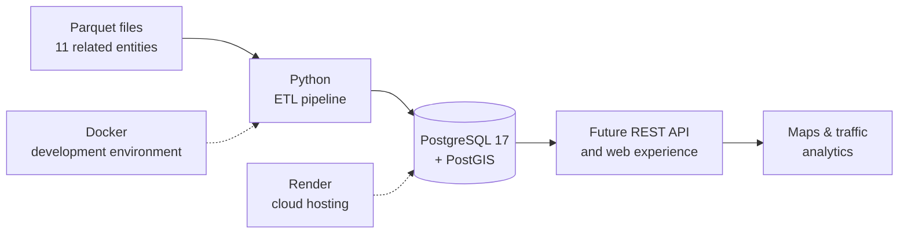

<div align="center">

# 🚗 Car Tracking

### A geospatial foundation for understanding vehicle movement

**Group INL** · **CIIC 4060 / ICOM 5016** · **Fall 2026**  
University of Puerto Rico, Mayagüez Campus  
Department of Electrical and Computer Engineering

<br>


*Building the data layer for future maps, vehicle tracking, and traffic insights.*

</div>

---

## 🌎 About the project

**Car Tracking** explores how vehicle and geographic data can be organized into a system for tracking movement across an area. The broader vision is an application that brings together vehicle locations, roads, parking areas, and related records to support interactive maps and meaningful traffic statistics.

Our starting point is **Phase I: Database & ETL**. This stage focuses on the foundation behind those experiences: a spatially enabled PostgreSQL database and a Python pipeline that imports the project's source data from Parquet files.

Rather than building the map interface first, we're focusing on the information it will depend on: consistent records, well-defined relationships, and geographic data that can be queried reliably.

## 🧭 How it fits together



The first part of this flow — **Parquet → Python ETL → PostgreSQL/PostGIS** — is the focus of Phase I. The API, visualization, and analytics pieces describe the direction of later phases, not features we're claiming are already complete.

## 🛠️ Technologies

| Technology | How it's used |
| :--- | :--- |
| **Python** | Reads the source files and runs the ETL process. |
| **PostgreSQL 17** | Stores the project's relational data. |
| **PostGIS** | Adds support for spatial geometry and geographic queries. |
| **Apache Parquet** | Provides the source datasets for the import pipeline. |
| **Render** | Hosts the project's cloud database. |
| **Docker** | Provides an isolated environment for development and testing. |

The application is designed around **Model–View–Controller (MVC)** principles as it grows. Database access is handled through Python services and SQL rather than an object-relational mapper (ORM); future client interfaces will communicate with the backend through a REST API instead of connecting directly to the database.

## 🗺️ Understanding the data

The course provides **11 related entities** as Parquet datasets, with their structure defined by a separate table diagram. Some of the central data categories are:

- **Roads:** geographic road features and attributes such as road classifications and speed limits.
- **Parking:** parking areas, their geometry, and descriptive information.
- **Pings:** timestamped GPS observations that capture vehicle positions and optional telemetry.
- **Vehicles:** vehicle records and their corresponding types.
- **Drivers:** fictional fleet-driver records and associated information.

Spatial data is represented through PostGIS geometry types, including **Points**, **LineStrings**, and **Polygons**. Coordinates use **WGS84 (SRID 4326)**, with longitude preceding latitude.

The database schema and imported records follow the project data and table diagram distributed through the course's Moodle page.

## ⚙️ Database & ETL

The ETL pipeline connects the source datasets to the database that will support the rest of the application. Its approach is straightforward:

1. **Extract** the supplied records from Parquet files.
2. **Prepare** the records for insertion while preserving their original values and the prescribed database structure.
3. **Load** the records into PostgreSQL tables, including their PostGIS geometries.

The source schema, geometry types, and values are intended to remain faithful to the supplied datasets. Development and validation take place in an isolated Docker environment before working with the cloud database on Render.

### Repository layout

```text
GROUP-INL/
├── ETL/            # Python ETL code
└── README.md       # Project overview and documentation
```

Additional configuration and development files can be added as the project evolves. The ETL entry point and execution commands will be documented alongside the implementation so they match the actual code.

### Database access

The production database is hosted on **Render** using **PostgreSQL 17 with PostGIS**. Authorized team members and course staff can obtain connection information through the team's private communication channels.

> **Security note:** Database passwords, full credential-bearing connection strings, and `.env` files should never be committed to a public repository.

## ✨ What's next

The longer-term Car Tracking experience brings the database to life through a **Python REST API**, a **map-based interface** using Google Maps or OpenStreetMap, and **dashboards** for exploring traffic activity. The database and ETL work establish the foundation for those future features.

## 👥 Meet Group INL

| Team member | GitHub |
| :--- | :--- |
| **Lex Feliciano** | [@lex939](https://github.com/lex939) |
| **Noel Colón** | [@noelcolon](https://github.com/noelcolon) |
| **Ismael Rivera** | [@irivera9](https://github.com/irivera9) |

We're collaborating on the project's database foundation and maintaining our work through GitHub as the application develops.

---

<div align="center">

**Group INL · Car Tracking**  
*CIIC 4060 / ICOM 5016 · Fall 2026 · UPR Mayagüez*

</div>
